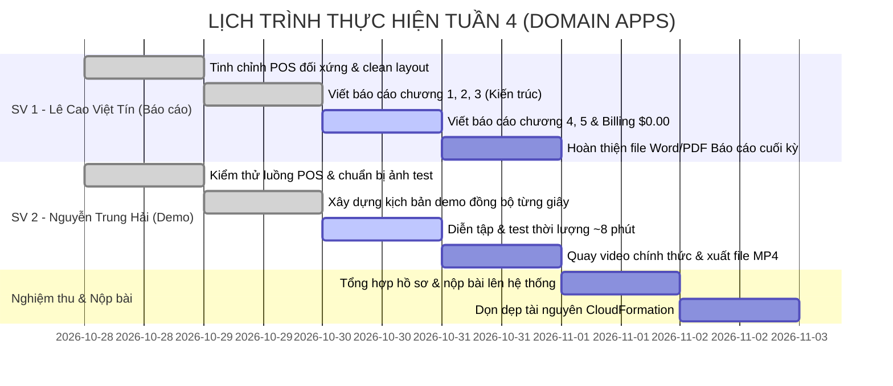

# KẾ HOẠCH TRIỂN KHAI CHI TIẾT TUẦN 4 (WEEK 4 MASTER PLAN)
## ĐỀ TÀI: HỆ THỐNG QUẢN LÝ BÃI GIỮ XE THÔNG MINH (SMART PARKING SYSTEM)

* **Học phần:** Điện toán đám mây (Cloud Computing) · Đợt 1 (2026 - 2027)
* **Giảng viên hướng dẫn (GVHD):** ThS. Huỳnh Xuân Phụng
* **Nhóm đề tài:** Domain Apps (Nhóm 2 sinh viên)
* **Phân công trách nhiệm chính:**
  - **Sinh viên 1 (Lê Cao Việt Tín - 24110354):** Phụ trách Báo cáo tổng kết đồ án, Sơ đồ kiến trúc, Báo cáo chi phí AWS ($0.00) & Kiểm thử an toàn.
  - **Sinh viên 2 (Nguyễn Trung Hải - 24110207):** Phụ trách Kịch bản demo, Kiểm thử vận hành hệ thống POS & Quay dựng Video Demo toàn trình ($\le$ 10 phút).
* **Môi trường triển khai:** AWS Learner Lab | Region: `us-east-1` (N. Virginia)
* **Thời gian thực hiện Tuần 4:** **28/10/2026 – 02/11/2026**
* **Kho lưu trữ Git:** [nthai212006-gh/cloud-smart-parking-system](https://github.com/nthai212006-gh/cloud-smart-parking-system) (Nhánh: `main`)

---

## 📌 PHẦN 1: ĐỐI CHIẾU KẾT QUẢ TUẦN 3 & ĐÁNH GIÁ CỦA GVHD

Trong đợt nghiệm thu Tuần 3, nhóm Domain Apps đã được GVHD ThS. Huỳnh Xuân Phụng đánh giá và phê duyệt với kết quả: **"ĐÃ DUYỆT"**.

### 1.1. Những điểm kỹ thuật xuất sắc được GVHD ghi nhận
1. **Xử lý Race Condition & Double Checkout:** Áp dụng thành công cơ chế **DynamoDB Atomic Conditional Write** với `ConditionExpression="#st = :parked OR #st = :active"` trong `backend/checkout.py`, ngăn chặn triệt để lỗi thanh toán trùng lặp ở tầng cơ sở dữ liệu.
2. **Kiểm thử bảo mật thật:** 
   - Kiểm soát Payload Base64 $> 5\text{MB}$ trả về đúng mã lỗi `HTTP 413 Payload Too Large`.
   - Script kiểm thử đa luồng `scripts/test_api_throttling.py` bắn 30 req/s bị API Gateway Throttling chặn đúng mã lỗi `HTTP 429 Too Many Requests`.
3. **Hạ tầng tự động hóa (IaC):** File `iac/cloudformation_template.yaml` khởi tạo trọn gói toàn bộ tài nguyên (S3, DynamoDB, Lambda, API Gateway, CloudWatch Alarms) chỉ bằng một lệnh duy nhất.
4. **Phân tích dữ liệu thật bằng Amazon Athena:** Truy vấn 5 câu SQL trên 50 vé xe thật, tính toán tổng doanh thu 1.124.000 VNĐ, thời gian quét 462ms tốn 11.60KB dữ liệu.
5. **Giám sát & Tối ưu chi phí:** 2 CloudWatch Alarms ở trạng thái `OK` xanh lá, chi phí AWS Billing duy trì an toàn tuyệt đối ở mức **`$0.00`**.

---

### 1.2. Yêu cầu trọng tâm của GVHD cho Tuần 4 (Bộ 3 Deliverables bắt buộc)
Căn cứ kết luận của GVHD:
> *"Tuần 4 chốt đồ án, bộ deliverable cuối phải đủ 3 thứ: **video demo toàn trình không quá 10 phút**, **báo cáo chi phí AWS** — nền nhóm đã có từ tuần 3 ($0.00) — và **dọn sạch tài nguyên sau khi demo**. Load/stress testing nhóm ghi trong kế hoạch, làm được càng tốt, nhưng 3 thứ trên là bắt buộc."*

---

## 🎯 PHẦN 2: MỤC TIÊU VÀ PHẠM VI CÔNG VIỆC TUẦN 4

Nhóm thống nhất chia tách khối lượng công việc thành 2 mũi nhọn độc lập, rõ ràng và cân bằng 50/50:

```
┌────────────────────────────────────────────────────────────────────────────────────────┐
│                        KẾ HOẠCH BÀN GIAO TUẦN 4 (17.0 GIỜ)                             │
├──────────────────────────────────────────┬─────────────────────────────────────────────┤
│  SINH VIÊN 1: LÊ CAO VIỆT TÍN (8.5 GIỜ)  │  SINH VIÊN 2: NGUYỄN TRUNG HẢI (8.5 GIỜ)    │
│       [TRỌNG TÂM: BÁO CÁO & KIẾN TRÚC]   │           [TRỌNG TÂM: VIDEO DEMO]           │
├──────────────────────────────────────────┼─────────────────────────────────────────────┤
│ 1. Viết Báo cáo tổng kết đồ án (Word/PDF)│ 1. Vận hành & kiểm thử hệ thống Desktop POS │
│ 2. Hoàn thiện sơ đồ kiến trúc Serverless │ 2. Xây dựng kịch bản demo đồng bộ từng giây │
│ 3. Lập báo cáo kiểm toán chi phí $0.00   │ 3. Quay và biên tập Video Demo (<= 10 phút) │
│ 4. Soạn tài liệu hướng dẫn dọn dẹp IaC   │ 4. Đăng tải video lên Drive/YouTube & nộp   │
└──────────────────────────────────────────┴─────────────────────────────────────────────┘
```

---

## 👥 PHẦN 3: KẾ HOẠCH CHI TIẾT TỪNG THÀNH VIÊN

---

### 3.1. SINH VIÊN 1: LÊ CAO VIỆT TÍN (MSSV: 24110354)
* **Vai trò:** Phụ trách Báo cáo tổng kết, Kiến trúc kỹ thuật, Quản trị chi phí & Tự động hóa.
* **Tổng số giờ làm việc:** **8.5 giờ**

| Ngày thực hiện | Khung giờ | Số giờ | Hạng mục công việc chi tiết | Sản phẩm bàn giao cụ thể |
| :---: | :---: | :---: | :--- | :--- |
| **28/10/2026**<br>(Thứ 4) | 19:30 - 21:30 | 2.0h | - Tinh chỉnh giao diện POS Desktop 5 tầng đối xứng (`frontend/index.html` và `frontend/style.css`).<br>- Khóa cứng kích thước Tầng 3 (48px) và Tầng 4 (44px) cân bằng giữa Cổng Vào và Cổng Ra.<br>- Loại bỏ các khung chờ nét đứt để giao diện gọn gàng, chuyên nghiệp.<br>- Kiểm tra tính toàn vẹn 45 DOM IDs trong `frontend/app.js`. | Commit `f90a317`, `986cf0c`<br>Giao diện POS đối xứng hoàn hảo |
| **29/10/2026**<br>(Thứ 5) | 19:30 - 21:45 | 2.25h | - Khởi tạo cấu trúc tài liệu Báo cáo tổng kết đồ án toàn trình 4 tuần.<br>- Xây dựng sơ đồ kiến trúc hệ thống chuẩn AWS Serverless Decoupled (API Gateway $\rightarrow$ Lambda $\rightarrow$ Rekognition/S3/DynamoDB $\rightarrow$ CloudWatch/Athena).<br>- Soạn thảo chương: *"Thiết kế kiến trúc hệ thống và luồng dữ liệu"*, bóc tách chi tiết luồng xử lý Check-in và Check-out. | Bản thảo Báo cáo chương 1, 2, 3<br>Sơ đồ kiến trúc độ nét cao |
| **30/10/2026**<br>(Thứ 6) | 14:00 - 16:15 | 2.25h | - Soạn thảo chương: *"Kiểm thử an toàn, Xử lý Race Condition và Stress Testing"*:<br>  + Giải thích cơ chế DynamoDB Atomic Write với `ConditionExpression`.<br>  + Phân tích cơ chế giới hạn tải API Gateway Throttling (10 req/s, burst 20).<br>- Lập báo cáo kiểm toán chi phí đám mây AWS Billing & Cost Management: Phân tích vì sao chi phí duy trì ở mức `$0.00` nhờ kiến trúc Serverless và Free Tier. | Báo cáo chương 4 & 5<br>Bảng phân tích chi phí AWS `$0.00` |
| **31/10/2026**<br>(Thứ 7) | 19:30 - 21:30 | 2.0h | - Rà soát file CloudFormation `iac/cloudformation_template.yaml`, bổ sung chương tài liệu hướng dẫn dọn dẹp tài nguyên 1-chạm (`aws cloudformation delete-stack`).<br>- Định dạng chuẩn hóa toàn bộ file Báo cáo tổng kết đồ án (Word và xuất bản PDF).<br>- Cập nhật nhật ký tuần `docs/worklogs/week-04/member-1.md`. | File Báo cáo tổng kết hoàn chỉnh<br>Tài liệu hướng dẫn dọn dẹp IaC |
| **TỔNG CỘNG** | | **8.5h** | **Đạt và vượt chuẩn quy định môn học ($\ge$ 8.0 giờ/tuần)** | **Hoàn thành 100% tài liệu báo cáo** |

---

### 3.2. SINH VIÊN 2: NGUYỄN TRUNG HẢI (MSSV: 24110207)
* **Vai trò:** Phụ trách Kịch bản demo, Vận hành hệ thống POS & Quay dựng Video Demo toàn trình.
* **Tổng số giờ làm việc:** **8.5 giờ**

| Ngày thực hiện | Khung giờ | Số giờ | Hạng mục công việc chi tiết | Sản phẩm bàn giao cụ thể |
| :---: | :---: | :---: | :--- | :--- |
| **28/10/2026**<br>(Thứ 4) | 19:30 - 21:30 | 2.0h | - Kiểm tra môi trường cục bộ: khởi chạy máy chủ web `python -m http.server 8000 --directory frontend`.<br>- Chuẩn bị dữ liệu mẫu kiểm thử: chọn lọc ảnh Ô tô (`test-images/01_car_clear/car_clear_01.jpg`) và ảnh Xe máy (`test-images/02_motor_clear/motor_clear_01.jpg`).<br>- Chạy thử luồng quét vé qua CAM 01 và CAM 02, xác thực ảnh xe ra được đẩy vào S3 thư mục `out/`. | Môi trường test sẵn sàng<br>Dữ liệu mẫu kiểm thử chuẩn hóa |
| **29/10/2026**<br>(Thứ 5) | 19:30 - 21:45 | 2.25h | - Soạn thảo Kịch bản Demo chi tiết theo cấu trúc phân cảnh từng giây ("Tay làm đâu - Miệng nói đó").<br>- Phân bổ thời lượng chuẩn cho 8 phân cảnh chính:<br>  + Phân cảnh 1: Mở đầu & Kiến trúc Serverless (40s)<br>  + Phân cảnh 2: Ô tô vào Làn 1 & Cấp vé tự động bằng Rekognition (1m15s)<br>  + Phân cảnh 3: Xe máy vào Làn 1 & Đọc biển số 2 dòng (45s)<br>  + Phân cảnh 4: Xe máy ra Làn 2 & Thu cước 5.000đ (1m15s)<br>  + Phân cảnh 5: Ô tô ra Làn 2 & 1-Click Checkout 20.000đ (45s)<br>  + Phân cảnh 6: Chống Double-Checkout & Test tải Throttling (1m15s)<br>  + Phân cảnh 7: Minh chứng AWS Console (DynamoDB, S3, Athena, Billing $0.00) (1m15s)<br>  + Phân cảnh 8: Kết luận & Kế hoạch dọn dẹp bằng CloudFormation (30s) | File `docs/plans/week-04/KICH_BAN_DEMO_VIDEO.md`<br>Lời thoại thuyết minh hoàn chỉnh |
| **30/10/2026**<br>(Thứ 6) | 14:00 - 16:15 | 2.25h | - Cài đặt phần mềm quay màn hình OBS Studio (1080p, 60fps, micro lọc tạp âm).<br>- Mở sẵn các tab trên trình duyệt: POS `http://localhost:8000`, AWS Console (DynamoDB, S3, Athena, CloudWatch Alarms `OK`, Billing `$0.00`).<br>- Chạy diễn tập toàn bộ 8 phân cảnh, đo đạc thời lượng video thực tế đạt **~8 phút** (nằm trọn vẹn trong khoảng an toàn $\le$ 10 phút). | Bản ghi thử nghiệm đạt chuẩn<br>Thời lượng khớp 8 phút |
| **31/10/2026**<br>(Thứ 7) | 19:30 - 21:30 | 2.0h | - Thực hiện quay Video Demo chính thức với giọng đọc to, rõ ràng, thao tác chuột dứt khoát.<br>- Hậu kỳ, cắt gọt đoạn thừa, xuất file định dạng MP4 độ phân giải cao.<br>- Tải video lên Google Drive (mở quyền xem công khai) và YouTube (chế độ Unlisted).<br>- Cập nhật nhật ký tuần `docs/worklogs/week-04/member-2.md`. | File Video Demo MP4 hoàn thiện<br>Link Drive/YouTube sẵn sàng nộp |
| **TỔNG CỘNG** | | **8.5h** | **Đạt và vượt chuẩn quy định môn học ($\ge$ 8.0 giờ/tuần)** | **Hoàn tất 100% video demo** |

---

## 📅 PHẦN 4: LỊCH TRÌNH BÀN GIAO & ĐỒNG BỘ TIẾN ĐỘ



---

## 📋 PHẦN 5: BỘ HỒ SƠ BÀN GIAO NGHIỆM THU CUỐI CÙNG

Nhóm chuẩn bị đầy đủ 4 hạng mục bàn giao theo đúng tiêu chuẩn đánh giá của GVHD:

1. **Kho mã nguồn GitHub:** Đầy đủ commit từ Tuần 1 đến Tuần 4, không có lỗi xung đột, kèm tài liệu hướng dẫn triển khai.
2. **Video Demo toàn trình:** Thời lượng **~8 phút** ($\le 10$ phút), định dạng MP4 1080p, lưu trữ trên Google Drive / YouTube Unlisted.
3. **Báo cáo tổng kết đồ án:** File Word và PDF trình bày đẹp mắt, đầy đủ sơ đồ kiến trúc, minh chứng chi phí `$0.00`, bảng kết quả kiểm thử tải và phân tích dữ liệu Athena.
4. **Nhật ký công việc (Worklogs):** Đầy đủ 4 tuần cho cả 2 thành viên trong thư mục `docs/worklogs/`, mỗi tuần đạt tối thiểu 17.0 giờ/nhóm.
