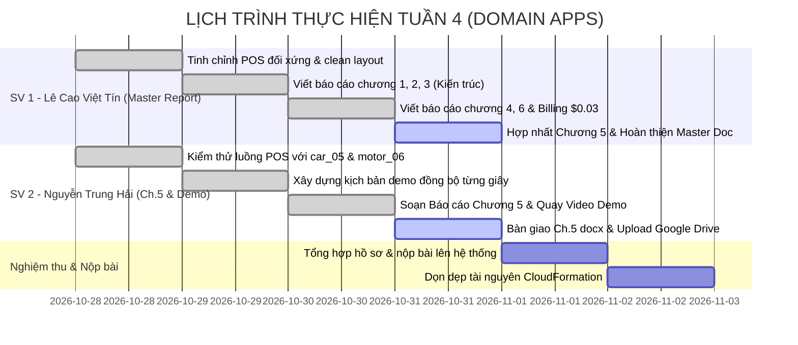

# KẾ HOẠCH TRIỂN KHAI CHI TIẾT TUẦN 4 (WEEK 4 MASTER PLAN)
## ĐỀ TÀI: HỆ THỐNG QUẢN LÝ BÃI GIỮ XE THÔNG MINH (SMART PARKING SYSTEM)

* **Học phần:** Điện toán đám mây (Cloud Computing) · Đợt 1 (2026 - 2027)
* **Giảng viên hướng dẫn (GVHD):** ThS. Huỳnh Xuân Phụng
* **Nhóm đề tài:** Domain Apps (Nhóm 2 sinh viên)
* **Phân công trách nhiệm chính:**
  - **Sinh viên 1 (Lê Cao Việt Tín - 24110354):** Phụ trách Báo cáo tổng kết đồ án (Chương 1, 2, 3, 4, 6, 7, 8 & Hợp nhất Master Report), Sơ đồ kiến trúc, Báo cáo chi phí AWS ($0.03) & Hướng dẫn dọn dẹp IaC.
  - **Sinh viên 2 (Nguyễn Trung Hải - 24110207):** Phụ trách Soạn thảo Chương 5 Báo cáo đồ án (Thực nghiệm, Kiểm thử & Giám sát hệ thống), Vận hành hệ thống POS, Kịch bản demo & Quay dựng Video Demo toàn trình ($\le$ 10 phút).
* **Môi trường triển khai:** AWS Learner Lab | Region: `us-east-1` (N. Virginia)
* **Thời gian thực hiện Tuần 4:** **28/10/2026 – 02/11/2026**
* **Kho lưu trữ Git:** [nthai212006-gh/cloud-smart-parking-system](https://github.com/nthai212006-gh/cloud-smart-parking-system) (Nhánh: `main`)
* **Thư mục Video Demo (Google Drive):** [Google Drive - Video Demo Hoàn Chỉnh](https://drive.google.com/drive/folders/1iYy8aeg6JkXlWysBVxFYQMlPEZcbFLb6?usp=drive_link)

---

## 📌 PHẦN 1: ĐỐI CHIẾU KẾT QUẢ TUẦN 3 & ĐÁNH GIÁ CỦA GVHD

Trong đợt nghiệm thu Tuần 3, nhóm Domain Apps đã được GVHD ThS. Huỳnh Xuân Phụng đánh giá và phê duyệt với kết quả: **"ĐÃ DUYỆT"**.

### 1.1. Những điểm kỹ thuật xuất sắc được GVHD ghi nhận
1. **Xử lý Race Condition & Double Checkout:** Áp dụng thành công cơ chế **DynamoDB Atomic Conditional Write** với `ConditionExpression="#st = :parked OR #st = :active"` trong `backend/checkout.py`, ngăn chặn triệt để lỗi thanh toán trùng lặp ở tầng cơ sở dữ liệu.
2. **Kiểm thử bảo mật thật:** 
   - Kiểm soát Payload Base64 $> 5\text{MB}$ trả về đúng mã lỗi `HTTP 413 Payload Too Large`.
   - Script kiểm thử đa luồng `scripts/test_api_throttling.py` bắn 30 req/s bị API Gateway Throttling chặn đúng mã lỗi `HTTP 429 Too Many Requests`.
3. **Hạ tầng tự động hóa (IaC):** File `iac/cloudformation_template.yaml` khởi tạo trọn gói toàn bộ tài nguyên (S3, DynamoDB, Lambda, API Gateway, CloudWatch Alarms) chỉ bằng một lệnh duy nhất.
4. **Phân tích dữ liệu thật bằng Amazon Athena:** Truy vấn 5 câu SQL trên 50 vé xe thật, tính toán tổng doanh thu 1.124.000 VNĐ, thời gian quét 462ms tốn 11.60KB dữ liệu.
5. **Giám sát & Tối ưu chi phí:** 2 CloudWatch Alarms ở trạng thái `OK` xanh lá, chi phí AWS Billing duy trì tối ưu ở mức **`$0.03`** (bảo toàn 99.97% ngân sách Lab).

---

### 1.2. Yêu cầu trọng tâm của GVHD cho Tuần 4 (Bộ 3 Deliverables bắt buộc)
Căn cứ kết luận của GVHD:
> *"Tuần 4 chốt đồ án, bộ deliverable cuối phải đủ 3 thứ: **video demo toàn trình không quá 10 phút**, **báo cáo chi phí AWS** — nền nhóm đã có từ tuần 3 ($0.00) — và **dọn sạch tài nguyên sau khi demo**. Load/stress testing nhóm ghi trong kế hoạch, làm được càng tốt, nhưng 3 thứ trên là bắt buộc."*

---

## 🎯 PHẦN 2: MỤC TIÊU VÀ PHẠM VI CÔNG VIỆC TUẦN 4

Nhóm thống nhất chia tách khối lượng công việc thành 2 mũi nhọn độc lập, rõ ràng và cân bằng 50/50:

```
┌────────────────────────────────────────────────────────────────────────────────────────┐
│                        KẾ HOẠCH BÀN GIAO TUẦN 4 (17.0 GIỜ)                             │
├──────────────────────────────────────────┬─────────────────────────────────────────────┤
│  SINH VIÊN 1: LÊ CAO VIỆT TÍN (8.5 GIỜ)  │  SINH VIÊN 2: NGUYỄN TRUNG HẢI (8.5 GIỜ)    │
│  [TRỌNG TÂM: MASTER REPORT & KIẾN TRÚC]  │  [TRỌNG TÂM: BÁO CÁO CHƯƠNG 5 & VIDEO DEMO] │
├──────────────────────────────────────────┼─────────────────────────────────────────────┤
│ 1. Viết Báo cáo Chương 1, 2, 3, 4, 6, 7,8│ 1. Viết Báo cáo Chương 5: Kiểm thử & Giám sát│
│ 2. Hoàn thiện sơ đồ kiến trúc Serverless │ 2. Vận hành & kiểm thử hệ thống Desktop POS │
│ 3. Lập báo cáo kiểm toán chi phí $0.03   │ 3. Quay và biên tập Video Demo DEMO.mp4     │
│ 4. Hợp nhất Master Report & Hướng dẫn IaC│ 4. Đăng tải video lên Google Drive & nộp    │
└──────────────────────────────────────────┴─────────────────────────────────────────────┘
```

---

## 👥 PHẦN 3: KẾ HOẠCH CHI TIẾT TỪNG THÀNH VIÊN

---

### 3.1. SINH VIÊN 1: LÊ CAO VIỆT TÍN (MSSV: 24110354)
* **Vai trò:** Phụ trách Báo cáo tổng kết, Kiến trúc kỹ thuật, Quản trị chi phí & Tự động hóa.
* **Tổng số giờ làm việc:** **8.5 giờ**

| Ngày thực hiện | Khung giờ | Số giờ | Hạng mục công việc chi tiết | Sản phẩm bàn giao cụ thể |
| :---: | :---: | :---: | :--- | :--- |
| **28/10/2026**<br>(Thứ 4) | 19:30 - 21:30 | 2.0h | - Tinh chỉnh giao diện POS Desktop 5 tầng đối xứng (`frontend/index.html` và `frontend/style.css`).<br>- Khóa cứng kích thước Tầng 3 (48px) và Tầng 4 (44px) cân bằng giữa Cổng Vào và Cổng Ra.<br>- Loại bỏ các khung chờ nét đứt để giao diện gọn gàng, chuyên nghiệp.<br>- Kiểm tra tính toàn vẹn 45 DOM IDs trong `frontend/app.js`. | Commit `f90a317`, `986cf0c`<br>Giao diện POS đối xứng hoàn hảo |
| **29/10/2026**<br>(Thứ 5) | 19:30 - 21:45 | 2.25h | - Khởi tạo cấu trúc tài liệu Báo cáo tổng kết đồ án toàn trình 4 tuần.<br>- Xây dựng sơ đồ kiến trúc hệ thống chuẩn AWS Serverless Decoupled (API Gateway $\rightarrow$ Lambda $\rightarrow$ Rekognition/S3/DynamoDB $\rightarrow$ CloudWatch/Athena).<br>- Soạn thảo chương: *"Thiết kế kiến trúc hệ thống và luồng dữ liệu"*, bóc tách chi tiết luồng xử lý Check-in và Check-out. | Bản thảo Báo cáo chương 1, 2, 3<br>Sơ đồ kiến trúc độ nét cao |
| **30/10/2026**<br>(Thứ 6) | 14:00 - 16:15 | 2.25h | - Soạn thảo Chương 4 (Triển khai các dịch vụ AWS) và Chương 6 (Đánh giá chi phí & Tối ưu hóa).<br>- Lập báo cáo kiểm toán chi phí đám mây AWS Billing & Cost Management: Phân tích thực tế chi phí **`$0.03`** (trong đó CloudWatch chiếm $0.02, Rekognition chiếm $0.01 do quá trình test tải và demo nhiều lượt), khẳng định mức tối ưu vượt trội, bảo toàn 99.97% ngân sách $100. | Bản thảo Chương 4, 6<br>Bảng phân tích chi phí AWS `$0.03` |
| **31/10/2026**<br>(Thứ 7) | 19:30 - 21:30 | 2.0h | - Tiếp nhận file Chương 5 (`BaoCao_Chuong_5_KiemThu_Va_GiamSat.docx`) từ Thành viên 2 (Hải) để hợp nhất vào Báo cáo tổng thể toàn trình (Chương 1 đến Chương 8).<br>- Rà soát file CloudFormation `iac/cloudformation_template.yaml`, hoàn thiện Chương 8: hướng dẫn dọn dẹp tài nguyên 1-chạm (`aws cloudformation delete-stack`).<br>- Định dạng chuẩn hóa toàn bộ file Báo cáo tổng kết đồ án Master (Word và xuất bản PDF).<br>- Cập nhật nhật ký tuần `docs/worklogs/week-04/member-1.md`. | File Báo cáo Master hoàn chỉnh<br>Tài liệu hướng dẫn dọn dẹp IaC |
| **TỔNG CỘNG** | | **8.5h** | **Đạt và vượt chuẩn quy định môn học ($\ge$ 8.0 giờ/tuần)** | **Hoàn thành Master Report** |

---

### 3.2. SINH VIÊN 2: NGUYỄN TRUNG HẢI (MSSV: 24110207)
* **Vai trò:** Phụ trách Soạn thảo Chương 5 Báo cáo đồ án, Vận hành kiểm thử POS & Quay dựng Video Demo toàn trình.
* **Tổng số giờ làm việc:** **8.5 giờ**

| Ngày thực hiện | Khung giờ | Số giờ | Hạng mục công việc chi tiết | Sản phẩm bàn giao cụ thể |
| :---: | :---: | :---: | :--- | :--- |
| **28/10/2026**<br>(Thứ 4) | 19:30 - 21:30 | 2.0h | - Kiểm tra môi trường cục bộ: khởi chạy máy chủ web `python -m http.server 8000 --directory frontend`.<br>- Lựa chọn bộ ảnh thử nghiệm thực tế chính thức: **Ô tô (`car_clear_05.jpg`)** và **Xe máy (`motor_clear_06.jpg`)**.<br>- Chạy thử nghiệm luồng quét vé qua CAM 01 và CAM 02, xác thực ảnh xe ra được đẩy vào S3 thư mục `out/`. | Môi trường test sẵn sàng<br>2 ảnh test `car_05` & `motor_06` |
| **29/10/2026**<br>(Thứ 5) | 19:30 - 21:45 | 2.25h | - Thiết kế cấu trúc các phân cảnh demo mượt mà, phân bổ thời lượng chuẩn khống chế $\le$ 10 phút.<br>- Chuẩn bị dữ liệu và mở sẵn các tab điều khiển trên AWS Console (DynamoDB, Athena, S3, CloudWatch, Billing).<br>- Diễn tập thao tác giữa POS và AWS Console. | Bảng phân cảnh demo<br>Môi trường kiểm thử sẵn sàng |
| **30/10/2026**<br>(Thứ 6) | 14:00 - 16:15 | 2.25h | - Soạn thảo hoàn thiện **Chương 5: Thực nghiệm, Kiểm thử và Giám sát hệ thống** (`BaoCao_Chuong_5_KiemThu_Va_GiamSat.docx`) gồm 3 nội dung: kiểm thử nhận diện biển số 120 ảnh & luồng POS; kiểm thử an toàn Race Condition DynamoDB; kiểm thử Throttling 30 req/s, phân tích SQL Athena 50 vé 1.124.000đ và CloudWatch Dashboard/Alarms.<br>- Cài đặt phần mềm quay màn hình, mở sẵn các tab: POS Desktop, AWS Console (DynamoDB items, S3 `in/` và `out/`, Athena SQL, CloudWatch Alarms `OK`, Billing `$0.03`).<br>- Chạy diễn tập và thực hiện quay video toàn trình chính thức `DEMO.mp4` với âm thanh rõ ràng, thời lượng đạt chuẩn $\le$ 10 phút. | File Báo cáo Chương 5 docx<br>File video `DEMO.mp4` |
| **31/10/2026**<br>(Thứ 7) | 19:30 - 21:30 | 2.0h | - Bàn giao file `BaoCao_Chuong_5_KiemThu_Va_GiamSat.docx` cho Thành viên 1 (Tín) ráp vào Báo cáo Master.<br>- Tải video lên Google Drive tại thư mục chia sẻ: [Google Drive Folder](https://drive.google.com/drive/folders/1iYy8aeg6JkXlWysBVxFYQMlPEZcbFLb6?usp=drive_link).<br>- Kiểm tra mở quyền xem công khai (Anyone with the link can view).<br>- Cập nhật nhật ký tuần `docs/worklogs/week-04/member-2.md` và đồng bộ tài liệu nghiệm thu. | Bàn giao Chương 5 docx<br>Link Google Drive video demo |
| **TỔNG CỘNG** | | **8.5h** | **Đạt và vượt chuẩn quy định môn học ($\ge$ 8.0 giờ/tuần)** | **Hoàn tất Báo cáo Ch.5 & Video Demo** |

---

## 📅 PHẦN 4: LỊCH TRÌNH BÀN GIAO & ĐỒNG BỘ TIẾN ĐỘ



---

## 📋 PHẦN 5: BỘ HỒ SƠ BÀN GIAO NGHIỆM THU CUỐI CÙNG

Nhóm chuẩn bị đầy đủ 4 hạng mục bàn giao theo đúng tiêu chuẩn đánh giá của GVHD:

1. **Kho mã nguồn GitHub:** Đầy đủ commit từ Tuần 1 đến Tuần 4, không có lỗi xung đột, kèm tài liệu hướng dẫn triển khai.
2. **Video Demo toàn trình:** File `DEMO.mp4` thời lượng đạt chuẩn ($\le 10$ phút), lưu trữ trên [Google Drive](https://drive.google.com/drive/folders/1iYy8aeg6JkXlWysBVxFYQMlPEZcbFLb6?usp=drive_link).
3. **Báo cáo tổng kết đồ án:** File Word và PDF trình bày đẹp mắt, đầy đủ sơ đồ kiến trúc, minh chứng chi phí thực tế `$0.03`, bảng kết quả kiểm thử tải và phân tích dữ liệu Athena.
4. **Nhật ký công việc (Worklogs):** Đầy đủ 4 tuần cho cả 2 thành viên trong thư mục `docs/worklogs/`, mỗi tuần đạt tối thiểu 17.0 giờ/nhóm.
