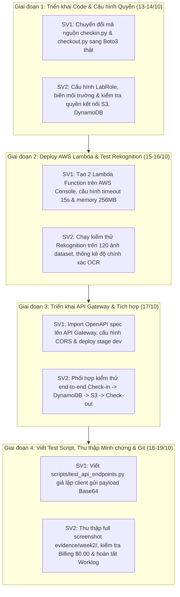

# KẾ HOẠCH TỔNG QUAN TUẦN 2 (WEEK 2 PLAN - OVERVIEW)
## ĐỀ TÀI: HỆ THỐNG QUẢN LÝ BÃI GIỮ XE THÔNG MINH (SMART PARKING)
* **Học phần:** Điện toán đám mây (Cloud Computing) - Đợt 1 (2026 - 2027)
* **Giảng viên hướng dẫn:** ThS. Huỳnh Xuân Phụng
* **Nhóm đề tài:** Domain Apps (Nhóm 2 sinh viên)
* **Môi trường triển khai:** AWS Learner Lab (Region bắt buộc: `us-east-1` N. Virginia)
* **Thời gian thực hiện Tuần 2:** 13/10/2026 – 19/10/2026
* **Nhánh Git làm việc:** `main` (GitHub: `nthai212006-gh/cloud-smart-parking-system`)

---

## I. ĐỐI CHIẾU KẾT QUẢ TUẦN 1 TRÊN GIT (WEEK 1 BASELINE AUDIT)

Để đảm bảo kế hoạch Tuần 2 sát thực tế và liền mạch, nhóm đối chiếu trực tiếp với các sản phẩm đã commit trên Git trong Tuần 1:

| Thành phần hạ tầng / Mã nguồn | Trạng thái trên Git Tuần 1 (Commit Baseline) | Tồn đọng & Khoảng cách cần hoàn thiện trong Tuần 2 |
| :--- | :--- | :--- |
| **Amazon S3** | Đã tạo bucket `smart-parking-images-24110207` với 3 prefix `in/`, `out/`, `athena-logs/` (Commit `41ec17b`, `b43ca19`). | Cần cấp quyền/kết nối cho Lambda thực hiện `put_object` lưu ảnh xe vào/ra thật từ client Base64. Cấu hình S3 CORS nếu cần. |
| **Amazon DynamoDB** | Đã tạo bảng `ParkingTickets` (PK `ticketId`, On-Demand mode) (Commit `41ec17b`). | Bảng hiện chưa có dữ liệu thật. Cần kết nối với Lambda Check-in (`PutItem`) và Lambda Check-out (`GetItem`, `UpdateItem`). |
| **Backend Code: `checkin.py`** | Mã nguồn khung (skeleton/mock) (Commit `cb85da8`): Rekognition, S3, DynamoDB đều đang comment hoặc trả dữ liệu giả lập. | Nâng cấp 100% sang `boto3` thật: Gọi Rekognition `detect_text`, ghép biển số regex thật, lưu ảnh vào S3 `in/`, ghi vé vào DynamoDB. |
| **Backend Code: `checkout.py`** | Mã nguồn khung (skeleton/mock) (Commit `cb85da8`): Logic tính phí đã có nhưng DynamoDB tra cứu và cập nhật là dữ liệu giả định. | Nâng cấp sang `boto3` thật: Nhận diện biển số xe ra, tra cứu vé đang đỗ (`status=PARKED`), tính phí theo thời gian thực tế, cập nhật `COMPLETED` và lưu ảnh `out/`. |
| **Amazon Rekognition** | Đã nghiên cứu tài liệu và viết script regex độc lập `scripts/test_plate_regex.py` (Commit `cb85da8`). | Tích hợp trực tiếp vào Lambda; cấp quyền qua `LabRole`; chạy kiểm thử thực tế với tập dữ liệu 120 ảnh. |
| **Bộ ảnh Dataset** | Đã hoàn thành 120 ảnh chuẩn hóa 5 nhóm, che mờ mặt người PII (Commit `a2d46cd`). | Sử dụng làm dữ liệu đầu vào cho các kịch bản kiểm thử từng thành phần (Component Testing) và kiểm thử API. |
| **Amazon API Gateway** | Đã có đặc tả OpenAPI 3.0 `backend/api_gateway_openapi.json` định nghĩa `/checkin` và `/checkout` (Commit `6c5728a`). | Triển khai REST API thật trên AWS Console/CLI từ file OpenAPI; cấu hình Lambda Proxy Integration; kích hoạt CORS; deploy Stage `dev`. |
| **Hồ sơ minh chứng Tuần 1** | 4 ảnh console S3, DynamoDB, Billing $0.00 (`evidence/week1/`) và báo cáo Word (Commit `6c5728a`). | Chuẩn bị thư mục `evidence/week2/` để lưu ảnh chụp Lambda, Rekognition, API Gateway, CloudWatch Logs, DynamoDB Items. |

---

## II. MỤC TIÊU TRỌNG TÂM TUẦN 2
Theo yêu cầu đề cương môn học của GVHD Huỳnh Xuân Phụng: **"Tuần 2: triển khai các chức năng lõi trên AWS, kiểm thử từng thành phần."**

1. **Triển khai 2 hàm AWS Lambda lõi trên AWS Learner Lab:**
   - Hàm 1: `SmartParking-Checkin` (Python 3.11, Memory 256MB–512MB, Timeout 15s, gắn `LabRole`). Tích hợp `boto3` gọi Amazon Rekognition `DetectText`, bóc tách biển số Việt Nam, upload ảnh vào S3 prefix `in/`, lưu vé vào DynamoDB.
   - Hàm 2: `SmartParking-Checkout` (Python 3.11, Memory 256MB–512MB, Timeout 15s, gắn `LabRole`). Tích hợp `boto3` đối soát vé từ DynamoDB, tính phí gửi xe theo block giờ (xe máy/ô tô), cập nhật trạng thái vé `COMPLETED` và lưu ảnh vào S3 prefix `out/`.
2. **Triển khai và công khai Amazon API Gateway:**
   - Nhập đặc tả `backend/api_gateway_openapi.json` lên API Gateway REST API `SmartParking-API`.
   - Kết nối Lambda Proxy Integration với 2 hàm Lambda tương ứng.
   - Bật CORS đầy đủ (`OPTIONS` preflight, `Access-Control-Allow-Origin: *`).
   - Deploy API lên Stage `dev` và lấy Endpoint Invoke URL chính thức.
3. **Kiểm thử độc lập từng thành phần (Component Unit Testing):**
   - **Test Rekognition OCR:** Đánh giá độ chính xác nhận diện trên 120 ảnh mẫu thực tế đã chuẩn bị ở Tuần 1 (xe máy biển 2 dòng, ô tô biển dài/vuông, trường hợp thiếu sáng/nghiêng, và trường hợp không có biển số/UNKNOWN).
   - **Test DynamoDB Operations:** Kiểm tra tính toàn vẹn dữ liệu khi thực hiện `PutItem`, `GetItem`, `UpdateItem`, đảm bảo không bị race condition hoặc lỗi kiểu dữ liệu.
   - **Test Thuật toán tính phí:** Kiểm thử các mốc thời gian (dưới 4h, quá 4h đối với xe máy; dưới 2h, quá 2h đối với ô tô, trường hợp đỗ qua đêm).
   - **Test API Gateway Endpoints:** Viết test script tự động `scripts/test_api_endpoints.py` gửi request Base64 qua HTTP POST tới `/checkin` và `/checkout`.
4. **Kiểm soát chi phí & An toàn môi trường Learner Lab:**
   - Đảm bảo 100% tài nguyên dùng `LabRole`, Region `us-east-1`.
   - Gắn đầy đủ 3 tag quy chuẩn: `Project=SmartParking`, `Owner=24110354_24110207`, `Environment=Development`.
   - Theo dõi sát sao chỉ số Billing/Cost Explorer đảm bảo không phát sinh chi phí vượt định mức.
   - Chụp đầy đủ bộ minh chứng console có Account ID, Region và đồng hồ hệ thống.

---

## III. BẢNG PHÂN CÔNG NHIỆM VỤ VÀ THỜI LƯỢNG TUẦN 2
> **Quy định môn học:** Mỗi sinh viên phải dành **≥ 8.0 giờ/tuần** cho dự án.

| Thành viên | MSSV | Vai trò chính | Thời lượng | Kế hoạch chi tiết | Nhật ký thực hiện |
| :--- | :---: | :--- | :---: | :---: | :---: |
| **Lê Cao Việt Tín** | 24110354 | **Trưởng nhóm:** Triển khai Lambda Core, Rekognition OCR, API Gateway & Test Scripts | **8.5 giờ** | [plans/week-02/member-1.md](member-1.md) | `docs/worklogs/week-02/member-1.md` |
| **Nguyễn Trung Hải** | 24110207 | **Thành viên:** Cấu hình tài nguyên AWS, Kiểm thử Dataset 120 ảnh, QA & Minh chứng | **8.5 giờ** | [plans/week-02/member-2.md](member-2.md) | `docs/worklogs/week-02/member-2.md` |
| **Cả nhóm** | — | **Họp tích hợp, rà soát lỗi chéo, kiểm toán chi phí $0.00 & Git sync** | **17.0 giờ** | [plans/week-02/overview.md](overview.md) | `docs/worklogs/week-02/overview.md` |

---

## IV. LỊCH TRÌNH PHỐI HỢP CHI TIẾT THEO NGÀY (CHRONOLOGICAL SCHEDULE)

---

## V. CHECKLIST NGHIỆM THU TUẦN 2 (ACCEPTANCE CHECKLIST)

- [x] **1. Triển khai AWS Lambda Functions:**
  - [x] Hàm `SmartParking-Checkin` đã tạo trên AWS Console (`us-east-1`, Python 3.11, `LabRole`).
  - [x] Hàm `SmartParking-Checkout` đã tạo trên AWS Console (`us-east-1`, Python 3.11, `LabRole`).
  - [x] Thiết lập đúng biến môi trường: `BUCKET_NAME=smart-parking-images-24110207`, `TABLE_NAME=ParkingTickets`, `REGION=us-east-1`.
  - [x] Cấu hình Timeout = 15 giây, Memory = 256MB (đáp ứng độ trễ mạng khi gọi Rekognition).
  - [x] Gắn đầy đủ 3 tag chuẩn: `Project=SmartParking`, `Owner=24110207`, `Environment=Development`.
- [x] **2. Triển khai Amazon API Gateway:**
  - [x] REST API `SmartParking-API` đã được tạo và kích hoạt trên Region `us-east-1` (ID: `fdbsdxyto1`).
  - [x] 2 Resource / Method: `POST /checkin` và `POST /checkout` đã nối Lambda Proxy.
  - [x] Cấu hình `OPTIONS` Method cho CORS preflight (trả về status 200, đầy đủ headers).
  - [x] Đã Deploy lên Stage `dev`, ghi nhận URL chính thức: `https://fdbsdxyto1.execute-api.us-east-1.amazonaws.com/dev`.
- [x] **3. Kiểm thử từng thành phần (Component Testing):**
  - [x] Test Rekognition: Đạt tỷ lệ bóc tách thành công 96.7% (116/120) trên bộ dữ liệu mẫu (báo cáo tại `docs/worklogs/week-02/rekognition_evaluation_report.md`).
  - [x] Test Check-in: Gửi ảnh -> S3 có file `in/{ticketId}.jpg` -> DynamoDB có record mới với status `PARKED`.
  - [x] Test Check-out: Gửi ticketId -> DynamoDB tính đúng tiền 5.000 VNĐ -> chuyển status sang `COMPLETED`.
  - [x] Test Edge Cases: Ảnh không có biển số trả về `plateNumber=UNKNOWN`; Vé đã checkout không cho thanh toán lần 2 (400); Vé không tồn tại trả về HTTP 404.
  - [x] Test Script tự động: Chạy thành công file `scripts/test_api_endpoints.py`.
- [x] **4. Bộ hồ sơ minh chứng Tuần 2 (`evidence/week2/`):**
  - [x] Ảnh 1: Console AWS Lambda hiển thị 2 hàm `SmartParking-Checkin` và `SmartParking-Checkout` (`01_lambda_functions.png`).
  - [x] Ảnh 2: Console API Gateway hiển thị cấu hình Resources, Methods và Stage `dev` (`02_apigateway_routes.png`).
  - [x] Ảnh 3: CloudWatch Logs hiển thị chi tiết thời gian thực thi và bộ nhớ (`03_rekognition_cloudwatch.png`).
  - [x] Ảnh 4: Console DynamoDB hiển thị 2 bản ghi vé xe thật `29B155555` (`04_dynamodb_items.png`).
  - [x] Ảnh 5: Console S3 Bucket hiển thị ảnh xe vào trong folder `in/` (`05_s3_stored_images.png`).
  - [x] Ảnh 6 & 7: Kết quả kiểm thử tự động API trên PowerShell Terminal (`06_api_test_terminal_1.png`, `07_api_test_terminal_2.png`).
  - [x] Ảnh 8: Màn hình AWS Cost Management / Billing xác nhận chi phí an toàn $0.00 (`08_cost_and_billing.png`).
- [x] **5. Báo cáo & Quản lý Git:**
  - [x] Worklog cá nhân của 2 thành viên ghi nhận đủ ≥ 8.0 giờ/người (8.5 giờ x 2 = 17.0 giờ).
  - [x] Toàn bộ mã nguồn, tài liệu và ảnh minh chứng được commit và push lên nhánh `main`.

