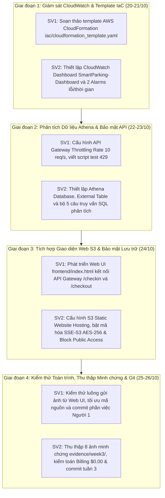

# KẾ HOẠCH TỔNG QUAN TUẦN 3 (WEEK 3 PLAN - OVERVIEW)
## ĐỀ TÀI: HỆ THỐNG QUẢN LÝ BÃI GIỮ XE THÔNG MINH (SMART PARKING)
* **Học phần:** Điện toán đám mây (Cloud Computing) - Đợt 1 (2026 - 2027)
* **Giảng viên hướng dẫn:** ThS. Huỳnh Xuân Phụng
* **Nhóm đề tài:** Domain Apps (Nhóm 2 sinh viên)
* **Môi trường triển khai:** AWS Learner Lab (Region bắt buộc: `us-east-1` N. Virginia)
* **Thời gian thực hiện Tuần 3:** 20/10/2026 – 26/10/2026
* **Nhánh Git làm việc:** `main` (GitHub: `nthai212006-gh/cloud-smart-parking-system`)

---

## I. ĐỐI CHIẾU KẾT QUẢ TUẦN 1 & TUẦN 2 TRÊN GIT (BASELINE AUDIT)

Để đảm bảo kế hoạch Tuần 3 sát thực tế và tiếp nối liền mạch, nhóm đối chiếu trực tiếp với các sản phẩm đã commit trên Git sau Tuần 1 và Tuần 2:

| Thành phần hạ tầng / Mã nguồn | Trạng thái trên Git (Hết Tuần 2) | Tồn đọng & Khoảng cách cần giải quyết trong Tuần 3 |
| :--- | :--- | :--- |
| **AWS Lambda & API Gateway** | Đã triển khai xong 2 hàm Boto3 (`checkin.py`, `checkout.py`) và REST API Gateway với 2 route `/checkin`, `/checkout` (Commit `4ced72a`, `619b547`). | Chưa có cơ chế Rate Limiting / Throttling chống spam; chưa có kịch bản xử lý tự động khi Lambda bị nghẽn thời gian thực thi (timeout) hoặc phát sinh lỗi runtime. |
| **Giám sát & Cảnh báo (CloudWatch)** | Chỉ có CloudWatch Logs cơ bản của từng đợt thực thi (Commit `619b547`). | Chưa có Dashboard trực quan gom metrics; chưa có CloudWatch Alarms để cảnh báo sự cố; chưa có bộ câu truy vấn Logs Insights chuyên sâu. |
| **Phân tích dữ liệu (Athena Analytics)** | S3 mới chỉ tạo folder `athena-logs/` (Commit `41ec17b`), chưa có database, chưa có bảng dữ liệu và chưa có truy vấn. | Cần tạo Database và External Table trên Athena; nạp dữ liệu vé xe và viết 5 câu truy vấn SQL phân tích doanh thu, giờ cao điểm và thống kê xe. |
| **Bảo mật lưu trữ (Storage Security)** | Bucket S3 và DynamoDB ở cấu hình mặc định, S3 đã bật CORS (Commit `d95bb33`). | Chưa bật mã hóa SSE-S3 AES-256; chưa kích hoạt Block Public Access bảo vệ dữ liệu ảnh vé xe nhạy cảm. |
| **Giao diện người dùng (Frontend UI)** | Toàn bộ kiểm thử hiện tại chạy trên Terminal (`scripts/test_api_endpoints.py`). | Cần một giao diện Web trực quan (Single Page HTML/JS) chạy trên S3 Static Website Hosting để chuẩn bị cho demo sản phẩm. |
| **Tự động hóa (IaC)** | Tài nguyên được tạo qua script Python riêng lẻ và cấu hình thủ công console. | Cần chuẩn hóa toàn bộ hạ tầng bằng AWS CloudFormation template (`iac/cloudformation_template.yaml`) để đảm bảo khả năng tái tạo nhanh. |

---

## II. MỤC TIÊU TRỌNG TÂM TUẦN 3
Theo đề cương môn học của GVHD Huỳnh Xuân Phụng: **"Tuần 3: tích hợp, bảo mật, giám sát (CloudWatch), tự động hóa/IaC nếu có"** và yêu cầu riêng của đề tài: **"dashboard thống kê theo giờ (Athena)"**.

1. **Giám sát tập trung (CloudWatch Monitoring & Alarms):**
   - Thiết lập CloudWatch Dashboard `SmartParking-Dashboard` với 4 widgets theo dõi Invocations, Errors, Duration và API Gateway Traffic.
   - Thiết lập 02 CloudWatch Alarms: `SmartParking-Lambda-Errors` (khi Errors >= 1) và `SmartParking-Lambda-Duration` (khi Duration > 5000ms).
   - Viết các mẫu truy vấn chuyên sâu trên CloudWatch Logs Insights.
2. **Phân tích kinh doanh bãi xe (Amazon Athena Analytics):**
   - Tạo Database `smart_parking_db`, External Table `parking_tickets_analytics`.
   - Thực thi 5 câu truy vấn SQL nghiệp vụ: Thống kê tổng doanh thu; Doanh thu theo loại xe; Khung giờ cao điểm; Thời gian đỗ trung bình; Tỷ lệ lỗi OCR `UNKNOWN`.
3. **Bảo mật nhiều lớp (Multi-layer Cloud Security):**
   - Bật Throttling & Quota (Rate: 10 req/s, Burst: 20 req) trên API Gateway Stage `dev`.
   - Bật mã hóa SSE-S3 (AES-256) và Block Public Access trên S3.
   - Kiểm tra và làm sạch dữ liệu đầu vào (Input Sanitization) tại Lambda.
4. **Tích hợp Web Dashboard & Tự động hóa IaC:**
   - Xây dựng giao diện Web tĩnh trên S3 Static Website Hosting (`frontend/index.html`, `app.js`).
   - Xây dựng mẫu AWS CloudFormation Template (`iac/cloudformation_template.yaml`) chuẩn hóa toàn bộ hạ tầng.
5. **Kiểm soát chi phí & Minh chứng console:**
   - Duy trì chi phí phát sinh an toàn $= \$0.00$, bảo toàn ngân sách $100.
   - Thu thập trọn bộ 8 ảnh màn hình console trong `evidence/week3/` theo chuẩn quy định.

---

## III. BẢNG PHÂN CÔNG NHIỆM VỤ VÀ THỜI LƯỢNG TUẦN 3
> **Quy định môn học:** Mỗi sinh viên phải dành **≥ 8.0 giờ/tuần** cho dự án.

| Thành viên | MSSV | Vai trò chính | Thời lượng | Kế hoạch chi tiết | Nhật ký thực hiện |
| :--- | :--- :--- | :---: | :--- | :---: | :---: |
| **Lê Cao Việt Tín** | 24110354 | **Trưởng nhóm:** Xây dựng CloudFormation IaC, cấu hình API Gateway Throttling, phát triển Web UI S3 | **8.5 giờ** | [member-1.md](member-1.md) | `docs/worklogs/week-03/member-1.md` |
| **Nguyễn Trung Hải** | 24110207 | **Thành viên:** Thiết lập CloudWatch Dashboard & Alarms, Athena Analytics, Bảo mật S3, QA & Minh chứng | **8.5 giờ** | [member-2.md](member-2.md) | `docs/worklogs/week-03/member-2.md` |
| **Cả nhóm** | — | **Họp tích hợp, kiểm thử bảo mật & tải, kiểm toán chi phí $0.00 & Git sync** | **17.0 giờ** | [overview.md](overview.md) | `docs/worklogs/week-03/overview.md` |

---

## IV. LỊCH TRÌNH PHỐI HỢP CHI TIẾT THEO NGÀY (CHRONOLOGICAL SCHEDULE)

---

## V. CHECKLIST NGHIỆM THU TUẦN 3 (ACCEPTANCE CHECKLIST)

- [ ] **1. Giám sát hệ thống (Amazon CloudWatch):**
  - [ ] CloudWatch Dashboard `SmartParking-Dashboard` được tạo với đủ 4 widgets.
  - [ ] CloudWatch Alarm `SmartParking-Lambda-Errors` (Errors >= 1 trong 5 phút) hoạt động chính xác.
  - [ ] CloudWatch Alarm `SmartParking-Lambda-Duration` (Duration > 5000ms trong 5 phút) hoạt động chính xác.
  - [ ] Truy vấn CloudWatch Logs Insights được lưu trữ và thực thi thành công.
- [ ] **2. Phân tích dữ liệu bãi xe (Amazon Athena):**
  - [ ] Database `smart_parking_db` và External Table `parking_tickets_analytics` đã tạo trên Athena.
  - [ ] 5 câu truy vấn SQL phân tích (doanh thu, loại xe, giờ cao điểm, thời gian đỗ, lỗi UNKNOWN) chạy trả kết quả chuẩn xác.
- [ ] **3. Bảo mật toàn diện (Security):**
  - [ ] Cấu hình Throttling (Rate: 10 req/s, Burst: 20 req) trên API Gateway Stage `dev`.
  - [ ] Kiểm thử phản hồi HTTP 429 Too Many Requests khi gửi request vượt ngưỡng.
  - [ ] Bật mã hóa SSE-S3 AES-256 và Block Public Access an toàn trên S3 bucket.
- [ ] **4. Tích hợp Web & IaC (Integration & Automation):**
  - [ ] Template AWS CloudFormation (`iac/cloudformation_template.yaml`) chuẩn hóa toàn bộ hạ tầng.
  - [ ] Giao diện Web tĩnh (`frontend/index.html`, `app.js`) chạy trên S3 Static Website Hosting kết nối API Gateway mượt mà.
- [ ] **5. Hồ sơ minh chứng & Quản lý Git:**
  - [ ] Bộ 8 ảnh minh chứng console trong `evidence/week3/` chụp đủ Account ID, Region và đồng hồ hệ thống.
  - [ ] Chi phí phát sinh duy trì an toàn ở mức **$0.00**.
  - [ ] Worklog cá nhân 2 sinh viên ghi nhận đủ $\ge 8.0$ giờ/người (tổng nhóm 17.0 giờ).
  - [ ] Toàn bộ mã nguồn, tài liệu và minh chứng được commit và push lên nhánh `main`.
