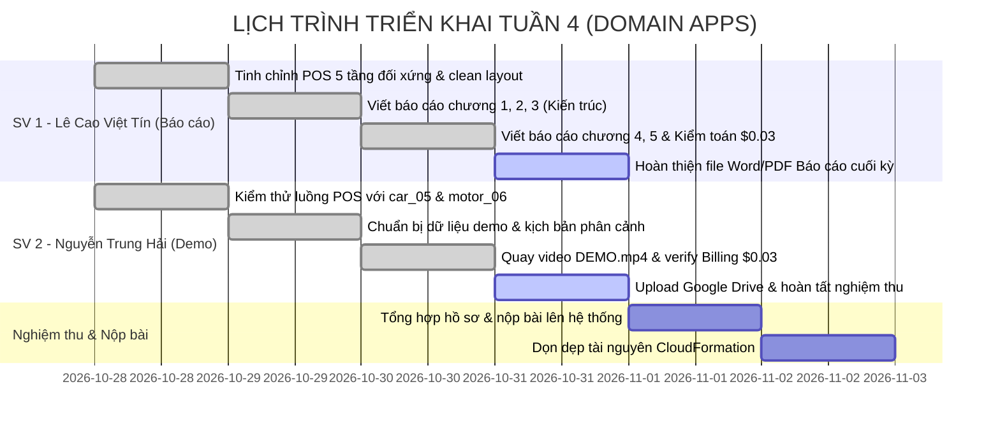

# KẾ HOẠCH TỔNG QUAN TUẦN 4 (WEEK 4 MASTER PLAN - OVERVIEW)
## ĐỀ TÀI: HỆ THỐNG QUẢN LÝ BÃI GIỮ XE THÔNG MINH (SMART PARKING SYSTEM)

* **Học phần:** Điện toán đám mây (Cloud Computing) · Đợt 1 (2026 - 2027)
* **Giảng viên hướng dẫn (GVHD):** ThS. Huỳnh Xuân Phụng
* **Nhóm đề tài:** Domain Apps (Nhóm 2 sinh viên)
* **Môi trường triển khai:** AWS Learner Lab | Region bắt buộc: `us-east-1` (N. Virginia)
* **Thời gian thực hiện Tuần 4:** **28/10/2026 – 02/11/2026**
* **Nhánh Git làm việc:** `main` (GitHub: [nthai212006-gh/cloud-smart-parking-system](https://github.com/nthai212006-gh/cloud-smart-parking-system))
* **Thư mục Video Demo (Google Drive):** [Google Drive - DEMO.mp4](https://drive.google.com/drive/folders/1iYy8aeg6JkXlWysBVxFYQMlPEZcbFLb6?usp=drive_link)

---

## I. ĐỐI CHIẾU KẾT QUẢ TUẦN 3 & ĐÁNH GIÁ CỦA GVHD

Trong đợt đánh giá Tuần 3, nhóm Domain Apps đã được GVHD ThS. Huỳnh Xuân Phụng phê duyệt với kết quả: **"ĐÃ DUYỆT"**.

### 1. Những điểm kỹ thuật xuất sắc được GVHD ghi nhận
1. **Xử lý Race Condition & Double Checkout:** Ứng dụng cơ chế **DynamoDB Atomic Conditional Write** với `ConditionExpression="#st = :parked OR #st = :active"` trong `backend/checkout.py`, ngăn chặn triệt để lỗi thanh toán trùng lặp ở tầng cơ sở dữ liệu.
2. **Kiểm thử bảo mật thật:** 
   - Kiểm soát Payload Base64 $> 5\text{MB}$ trả về đúng mã lỗi `HTTP 413 Payload Too Large`.
   - Script kiểm thử đa luồng `scripts/test_api_throttling.py` bắn 30 req/s bị API Gateway Throttling chặn đúng mã lỗi `HTTP 429 Too Many Requests`.
3. **Hạ tầng tự động hóa (IaC):** File `iac/cloudformation_template.yaml` định nghĩa toàn bộ tài nguyên (S3, DynamoDB, Lambda, API Gateway, CloudWatch Alarms) chỉ bằng một lệnh duy nhất.
4. **Phân tích dữ liệu bằng Amazon Athena:** Truy vấn SQL trên 50 vé xe thật, tính toán tổng doanh thu 1.124.000 VNĐ, thời gian quét 462ms tốn 11.60KB dữ liệu.
5. **Giám sát & Tối ưu chi phí:** 2 CloudWatch Alarms ở trạng thái `OK` xanh lá, chi phí thực tế duy trì ở mức tối ưu **`$0.03`** (bảo toàn 99.97% hạn mức $100 Lab).

### 2. Yêu cầu trọng tâm của GVHD cho Tuần 4 (Bộ 3 Deliverables bắt buộc)
Căn cứ chỉ đạo của GVHD:
> *"Tuần 4 chốt đồ án, bộ deliverable cuối phải đủ 3 thứ: **video demo toàn trình không quá 10 phút**, **báo cáo chi phí AWS** — nền nhóm đã có từ tuần 3 ($0.00) — và **dọn sạch tài nguyên sau khi demo**. Load/stress testing nhóm ghi trong kế hoạch, làm được càng tốt, nhưng 3 thứ trên là bắt buộc."*

---

## II. MỤC TIÊU VÀ PHÂN CÔNG TRỌNG TÂM TUẦN 4

Nhóm thống nhất chia tách khối lượng công việc thành 2 mũi nhọn độc lập, rõ ràng và cân bằng 50/50:

```
┌────────────────────────────────────────────────────────────────────────────────────────┐
│                        KẾ HOẠCH BÀN GIAO TUẦN 4 (17.0 GIỜ)                             │
├──────────────────────────────────────────┬─────────────────────────────────────────────┤
│  SINH VIÊN 1: LÊ CAO VIỆT TÍN (8.5 GIỜ)  │  SINH VIÊN 2: NGUYỄN TRUNG HẢI (8.5 GIỜ)    │
│       [TRỌNG TÂM: BÁO CÁO & KIẾN TRÚC]   │           [TRỌNG TÂM: VIDEO DEMO]           │
├──────────────────────────────────────────┼─────────────────────────────────────────────┤
│ 1. Viết Báo cáo tổng kết đồ án (Word/PDF)│ 1. Vận hành & kiểm thử hệ thống Desktop POS │
│ 2. Hoàn thiện sơ đồ kiến trúc Serverless │ 2. Thực hiện demo với ảnh car_05 & motor_06 │
│ 3. Lập báo cáo kiểm toán chi phí $0.03   │ 3. Quay và biên tập Video Demo DEMO.mp4     │
│ 4. Soạn tài liệu hướng dẫn dọn dẹp IaC   │ 4. Đăng tải video lên Google Drive & nộp    │
└──────────────────────────────────────────┴─────────────────────────────────────────────┘
```

### Bảng phân công thời lượng chi tiết:
> **Quy định môn học:** Mỗi sinh viên phải dành **≥ 8.0 giờ/tuần** cho dự án.

| Thành viên | MSSV | Vai trò chính Tuần 4 | Thời lượng | Kế hoạch chi tiết | Nhật ký thực hiện |
| :--- | :---: | :--- | :---: | :---: | :---: |
| **Lê Cao Việt Tín** | 24110354 | **Thành viên 1:** Viết Báo cáo tổng kết (Word/PDF), Sơ đồ kiến trúc Serverless, Báo cáo chi phí AWS ($0.03), Hướng dẫn dọn dẹp CloudFormation | **8.5 giờ** | [member-1.md](member-1.md) | `docs/worklogs/week-04/member-1.md` |
| **Nguyễn Trung Hải** | 24110207 | **Thành viên 2:** Vận hành hệ thống POS, Kiểm thử nghiệp vụ, Quay và hoàn thiện Video Demo toàn trình ($\le$ 10 phút), Upload Google Drive | **8.5 giờ** | [member-2.md](member-2.md) | `docs/worklogs/week-04/member-2.md` |
| **CẢ NHÓM** | — | **Nghiệm thu đồ án, rà soát hồ sơ bàn giao, sẵn sàng dọn dẹp hạ tầng** | **17.0 giờ** | [overview.md](overview.md) | `docs/worklogs/week-04/overview.md` |

---

## III. LỊCH TRÌNH PHỐI HỢP CHI TIẾT THEO NGÀY



---

## IV. BỘ HỒ SƠ BÀN GIAO NGHIỆM THU CUỐI CÙNG

Nhóm chuẩn bị đầy đủ 4 hạng mục bàn giao theo đúng tiêu chuẩn đánh giá của GVHD:

1. **Kho mã nguồn GitHub:** Đầy đủ commit từ Tuần 1 đến Tuần 4, không có lỗi xung đột, kèm tài liệu hướng dẫn triển khai.
2. **Video Demo toàn trình:** File `DEMO.mp4` thời lượng đạt chuẩn 9 phút 16 giây ($\le 10$ phút), lưu trữ trên [Google Drive Folder](https://drive.google.com/drive/folders/1iYy8aeg6JkXlWysBVxFYQMlPEZcbFLb6?usp=drive_link).
3. **Báo cáo tổng kết đồ án:** File Word và PDF trình bày đẹp mắt, đầy đủ sơ đồ kiến trúc, minh chứng chi phí thực tế `$0.03`, bảng kết quả kiểm thử tải và phân tích dữ liệu Athena.
4. **Nhật ký công việc (Worklogs):** Đầy đủ 4 tuần cho cả 2 thành viên trong thư mục `docs/worklogs/`, mỗi tuần đạt tối thiểu 17.0 giờ/nhóm.
